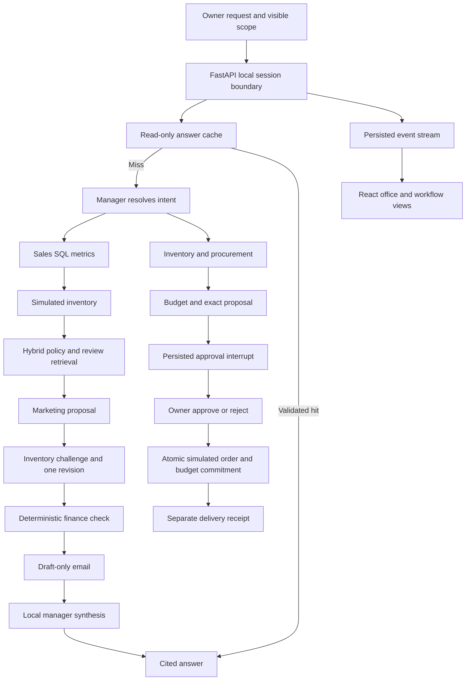

# Implementation architecture

SQLite is the source of authority for financial simulation. The model cannot call the executor or supply owner identity. The decision API validates a server-held local-session token; the executor rechecks status, digest, expiry, snapshot, offer, stock, inbound and budget in one transaction. Approved execution commits once per action ID. A crash between the transaction and graph continuation leaves an executed action that can safely resume without repeating the purchase.

The generation layer receives compact evidence packets and a deterministic conclusion. It returns schema-validated JSON and citation IDs. Verified facts are rendered separately, because schema/citation validation cannot prove every generated sentence. Failed generation is logged and returns a failed workflow; no silent cloud or template fallback occurs.

Cache guards bind reusable text to structured task scope and a snapshot of dataset, simulation version, model digest, prompt and embedding mode. Unrecognized qualifiers are retained in scope. This conservative parser is an explicit limitation and motivates the near-miss tests. A2 deliberately omits guards only in separate evaluation databases.

Each specialist is a bounded graph node with a domain-specific function and output. The Manager, Sales, Inventory, Research, Marketing, Procurement, Finance and Email are logical agents sharing one model service. In this implementation deterministic specialists do most tool work; one local generation call synthesizes the final read-only answer. The project evaluates answer reuse for this architecture, not the effectiveness of eight independent language models.
